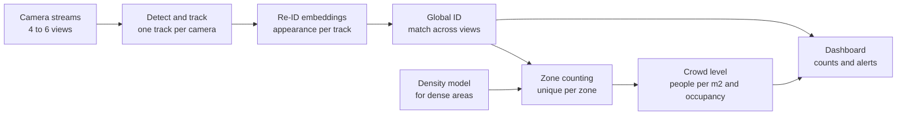

# Computer Vision Assignment: Multi-Camera Person Re-ID and Crowd Analysis

> **Level:** Beginner to Advanced · **Team size:** 1 · **Duration:** 3 weeks · **Language:** Python (PyTorch and OpenCV recommended)

You will build a system that watches several cameras at once, recognises that a person seen from different angles is **one** individual (not many), and reports how many people are in each area and whether it is crowded.

This assignment is a **learning path**. It starts with setup and small warm-up exercises, then moves level by level to a full multi-camera system and advanced topics (VLM, VLA and custom implementations). Every level has: what to learn, small ungraded warm-ups, the graded task, a checkpoint that tells you when you are done, and common mistakes to avoid.

---

## Table of Contents

1. [Overview and scenario](#1-overview-and-scenario)
2. [Learning path at a glance](#2-learning-path-at-a-glance)
3. [Setup, data and repository layout](#3-setup-data-and-repository-layout)
4. [Level 0: Foundations and setup](#level-0-foundations-and-setup-ungraded)
5. [Level 1 (Task 1): Person detection and single-camera tracking](#level-1-task-1-person-detection-and-single-camera-tracking-15-marks)
6. [Level 2 (Task 2): Cross-camera person re-identification](#level-2-task-2-cross-camera-person-re-identification-25-marks)
7. [Level 3 (Task 3): People counting per zone](#level-3-task-3-people-counting-per-zone-20-marks)
8. [Level 4 (Task 4): Crowded or not crowded](#level-4-task-4-crowded-or-not-crowded-10-marks)
9. [Level 5 (Task 5): Integrated pipeline and dashboard](#level-5-task-5-integrated-pipeline-and-dashboard-15-marks)
10. [Level 6: Advanced topics (VLM, VLA, custom implementations)](#level-6-advanced-topics-vlm-vla-and-custom-implementations)
11. [Evaluation metrics](#evaluation-metrics)
12. [Deliverables, grading and timeline](#deliverables-grading-and-timeline)
13. [What you will learn](#what-you-will-learn)
14. [Academic integrity and ethics](#academic-integrity-and-ethics)

---

## 1. Overview and scenario

**Scenario.** An office building has 4 to 6 cameras covering conference rooms, an open-plan floor, corridors and a lobby. Some views overlap (an open-plan floor seen from two sides); others do not (the lobby and a conference room). The same person walks through several views, wearing the same clothes but appearing at different angles, scales and lighting. The security and facilities team wants three answers in near real time:

1. How many *unique* people are in the building, and in each zone?
2. Is a given zone crowded or not, given its floor area and capacity?
3. Where has a given person been (a global track across cameras)?

**After this assignment you can:**

- Detect and track people in a single video stream.
- Learn and use appearance embeddings for person re-identification (Re-ID).
- Link tracks across cameras so one person gets one global ID.
- Count people per zone and avoid double-counting in overlapping views.
- Classify a zone as crowded or not using density estimation, floor area, capacity and thresholds.
- Evaluate with standard tracking, Re-ID and counting metrics.

### System at a glance



---

## 2. Learning path at a glance

Work through the levels in order. Each level builds on the one before it.

| Level | Focus | Graded task | Marks | Suggested time |
| --- | --- | --- | --- | --- |
| 0 | Foundations: environment, video I/O, geometry basics, git | none (warm-ups only) | 0 | Day 1 |
| 1 | Detection and single-camera tracking | Task 1 | 15 | Days 2 to 4 |
| 2 | Re-ID and cross-camera linking | Task 2 | 25 | Days 5 to 10 |
| 3 | Counting per zone with floor geometry | Task 3 | 20 | Days 9 to 13 |
| 4 | Crowd decisions: density, occupancy, thresholds | Task 4 | 10 | Days 13 to 15 |
| 5 | System integration, dashboard, reproducibility | Task 5 | 15 | Days 16 to 19 |
| 6 | VLM, VLA, custom implementations, other topics | Advanced track | bonus | Days 19 to 21 |
| Report | Report, demo video, code quality | n/a | 15 | Throughout |

---

## 3. Setup, data and repository layout

### Datasets

Use one multi-camera dataset for the main pipeline and, if needed, a separate crowd dataset for density training. If you record your own footage, use at least 5 cameras and 10 minutes of video with 8 or more people walking between views.

| Dataset | Use in this assignment | Notes |
| --- | --- | --- |
| WILDTRACK | Multi-camera detection, overlapping views, counting | 7 synchronised cameras, calibrated, ground-plane annotations |
| DukeMTMC-reID / DukeMTMC | Cross-camera tracking and Re-ID | 8 cameras; check current availability and licence |
| Market-1501 | Train and evaluate the Re-ID model | 1,501 identities, 6 cameras, cropped person images |
| CrowdHuman | Detection in dense scenes | Full-body and head boxes |
| ShanghaiTech (Part A/B) | Crowd density and counting | Point annotations per head |
| Own recording | Demo and final evaluation | Annotate a small ground-truth set (see below) |

### Zones and floor area

Divide the floor plan into at least 4 named zones, such as a *Conference Room*, an *Open-Plan Floor*, a *Corridor* and a *Lobby*. Draw each zone as a polygon on its camera view (and on the floor plan, if you calibrate a homography) and store it in `zones.json` with its floor area in square metres and its capacity. Measure the area from the building floor plan or a tape measure, or estimate it from known objects such as 0.6 m ceiling tiles or a 0.9 m door.

| Zone (example) | Area (m²) | Capacity |
| --- | --- | --- |
| Conference Room | 25 | 10 seats |
| Open-Plan Floor | 200 | 20 desks |
| Corridor | 30 | no seats |
| Lobby | 60 | 8 seats |

These values are examples. Replace them with your own measurements and state how you measured each.

Example `zones.json`:

```json
{
  "zones": [
    {
      "name": "Conference Room",
      "camera_id": "cam1",
      "polygon_px": [[120, 300], [620, 290], [640, 470], [100, 480]],
      "area_m2": 25.0,
      "capacity": 10
    }
  ]
}
```

### Ground truth you must create

Hand-label 100 frames (spread across cameras and time) with:

- the number of people in each zone,
- a crowded or not-crowded tag,
- for 30 identities, a short list of the cameras and times at which they appear.

### Suggested tools

PyTorch, OpenCV, Ultralytics YOLO or a similar detector, `torchreid` for Re-ID, ByteTrack or DeepSORT for tracking, Shapely for zones, Streamlit or Flask for the dashboard, pytest for tests.

### Suggested repository layout

```text
.
├── ASSIGNMENT.md
├── README.md                 # how to run your project
├── requirements.txt
├── configs/
│   ├── config.yaml           # cameras, thresholds, paths
│   └── zones.json            # polygons, area_m2, capacity
├── data/                     # git-ignored: videos, datasets, annotations
├── src/
│   ├── detection/
│   ├── tracking/
│   ├── reid/
│   ├── geometry/             # homography, floor plan, zone tests
│   ├── counting/
│   ├── crowd/
│   ├── vlm/                  # Level 6 (optional)
│   ├── pipeline/
│   └── dashboard/
├── scripts/                  # 00_check_setup.py, train_reid.py, evaluate.py
├── tests/                    # unit tests, including custom implementations
├── notebooks/                # exploration only
├── outputs/                  # tracks, global_ids, zone_counts (CSV or JSON)
└── report/                   # PDF report and demo video link
```

Commit small and often: one branch per level, merged when its checkpoint passes.

---

## Level 0: Foundations and setup (ungraded)

**Goal:** a working environment and the small building blocks every later level needs.

**Learn**

- Python environments (venv or conda), pinned `requirements.txt`, GPU check.
- OpenCV video reading and writing, frame timestamps, drawing boxes and polygons.
- NumPy arrays, image and pixel coordinates, the idea of a foot point.
- Git branching and commit hygiene.

**Warm-ups**

1. Read a video and write a copy with the frame number and timestamp drawn on each frame.
2. Draw a polygon on a frame and test whether a clicked point is inside it.
3. Measure the frames per second of a simple read-and-draw loop.
4. Align two videos by timestamp and show them side by side.

**Checkpoint:** `python scripts/00_check_setup.py` prints library versions and GPU status, and reads a sample video without errors.

---

## Level 1 (Task 1): Person detection and single-camera tracking (15 marks)

**Goal:** stable tracks inside each camera. Every later task depends on this.

**Learn**

- What a detector outputs: boxes, scores, classes; confidence threshold and NMS.
- IoU, and how trackers use it.
- Kalman filter intuition (predict where the box will be) and the Hungarian algorithm (best assignment of detections to tracks).
- Tracking metrics: MOTA, IDF1, ID switches.

**Warm-ups**

1. Run a pretrained detector on one image and plot a histogram of scores.
2. Write an IoU function and test it with simple boxes.
3. Track one short clip with an off-the-shelf tracker and count ID switches by eye.

**Requirements**

- Run a person detector on every frame (or every 2nd frame) of each camera. Report the model, input size and confidence threshold.
- Link detections into tracks using a tracker such as ByteTrack, DeepSORT or your own Kalman filter plus Hungarian matching.
- Handle short occlusions: keep a lost track alive for N frames (justify your N) before deleting it.
- Save per-camera output as `camera_id, frame, local_track_id, x1, y1, x2, y2, score`.

**Analysis questions**

1. How do the confidence and NMS thresholds change missed people versus false alarms? Show 2 settings with examples.
2. Where does your tracker switch IDs? Show 3 failure cases and explain the cause (occlusion, similar clothes, crowd density).

**Checkpoint:** a tracks file exists for every camera, and you have IDF1 and ID-switch numbers on a 1-minute labelled clip.

**Common mistakes:** cameras recorded at different frame rates; deleting tracks too early; detecting posters, mirrors or glass reflections as people.

---

## Level 2 (Task 2): Cross-camera person re-identification (25 marks)

**Goal:** a person seen by Camera 1 and later by Camera 3 keeps one **global ID**. This is the core of the assignment.

**Learn**

- Metric learning: embeddings, cosine distance, identity loss and triplet loss.
- Re-ID metrics: Rank-1, Rank-5, mAP and the CMC curve.
- Why Re-ID is hard: viewpoint, lighting, clothing similarity, domain gap between datasets.
- Homography: mapping floor points between a camera view and a floor plan.

**Warm-ups**

1. Extract embeddings for 20 person crops and visualise them with t-SNE or UMAP.
2. Compute Rank-1 and mAP on Market-1501 with a pretrained model.
3. Compute a homography from 4 known floor points (for example corners of floor tiles) and project a foot point.

**Requirements**

1. **Embedding model.** Train or fine-tune a Re-ID network (for example OSNet or a ResNet-50 with a BNNeck) on Market-1501 or your dataset. Use identity (cross-entropy) loss plus triplet loss. Output an L2-normalised embedding per person crop.
2. **Track-level features.** Average the embeddings of the best crops in each local track (sharp, unoccluded, large) instead of matching single frames.
3. **Matching.** Compute cosine distance between tracks from different cameras. Assign global IDs with the Hungarian algorithm or clustering, and apply a distance threshold to decide "new person" versus "same person".
4. **Constraints to reduce errors.** Use at least two of the following:
    - Time: a person cannot appear in two distant cameras at the same moment.
    - Camera topology: only compare cameras that are connected (travel time window).
    - Ground-plane position for overlapping cameras (use a homography to compare feet positions).
    - Re-ranking (k-reciprocal) of the distance matrix.
5. **Output.** Save `global_id, camera_id, local_track_id, frame_start, frame_end`.

**Experiments to report**

- Compare at least two embedding settings, for example ImageNet features only versus fine-tuned, or with and without re-ranking.
- Show a similarity matrix for 10 identities and discuss confusions (similar clothing, strong viewpoint change, lighting).
- Show 5 successful and 5 failed cross-camera matches as image strips with the cosine distance for each.

**Checkpoint:** a global ID table exists, and cross-camera IDF1 and Rank-1 are reported on a split with no identity shared between training and test.

**Common mistakes:** identity leakage between train and test; tuning the threshold on the test set; matching single frames instead of tracks; ignoring the time constraint.

---

## Level 3 (Task 3): People counting per zone (20 marks)

**Goal:** count unique people in each zone at any time, without counting the same person twice when two cameras see the same area.

**Learn**

- Point-in-polygon tests, and why the foot point (not the box centre) is the right point.
- Merging detections from overlapping cameras on a shared ground plane.
- Density maps: Gaussian kernels on head points, and counting as the integral of the map.
- Temporal smoothing.

**Warm-ups**

1. Build a density map from the point annotations of one ShanghaiTech image and check that its sum matches the head count.
2. Apply a moving average to a noisy count series and plot before and after.
3. Project two cameras' foot points to the floor plan and check how close they land for the same person.

**Requirements**

1. **Instant count.** For each frame, count tracked people whose foot point (bottom centre of the box) lies inside a zone polygon. Use `cv2.pointPolygonTest` or Shapely.
2. **De-duplication.** In overlapping views, project foot points to a common ground plane with a homography and merge detections closer than a set distance (for example 0.5 m), or merge by global ID from Task 2. Explain which method you chose.
3. **Dense scenes.** When people overlap heavily, detection undercounts. Add a density-map model (for example CSRNet or a similar lightweight network) and use its integral as the count for the zone. Compare it with detector counts.
4. **Building total.** Report the number of unique global IDs currently present across all cameras, plus the cumulative unique visitors over the video.
5. **Smoothing.** Apply a moving average or median filter over 1 to 3 seconds so the count does not flicker.

**Report:** a plot of count versus time for each zone, with your ground-truth points overlaid, and a short discussion of where counting fails.

**Checkpoint:** MAE and RMSE per zone are computed against your hand-labelled frames.

**Common mistakes:** using the box centre, which puts people in the wrong zone because of perspective; forgetting to de-duplicate overlapping cameras; not smoothing.

---

## Level 4 (Task 4): Crowded or not crowded (10 marks)

**Goal:** turn counts into a decision. A zone is crowded when people per square metre is high, not only when the raw count is high, because a large open floor holds more people comfortably than a small meeting room.

**Learn**

- Density and occupancy as measures of crowding.
- Thresholds, hysteresis and why raw decisions flicker.
- Classification metrics: accuracy, precision, recall, F1, confusion matrix.

**Warm-up:** for each zone in `zones.json`, compute density and occupancy for a few hand-picked counts and check the labels make sense.

$$D_z = \frac{N_z}{A_z}$$

Here $N$ is the people count in zone $z$ and $A$ is the zone area in square metres.

Use three levels with thresholds you justify, for example:

| Level | Density (people/m²) | Meaning |
| --- | --- | --- |
| Not crowded | below 0.5 | Free movement |
| Moderate | 0.5 to 1.5 | Walking is slower |
| Crowded | above 1.5 | Hard to move, alert the operator |

Office spaces need their own thresholds. A meeting room is full when the people present reach its seats, and an open-plan floor already feels busy at far fewer than 0.5 people/m² (2 m² each), because desks take up much of the area. Set thresholds per zone type from the area and capacity in `zones.json`, and also report the occupancy ratio:

$$Occ_z = \frac{N_z}{C_z}$$

Here $C$ is the capacity (seats or desks) of zone $z$. For example, 9 people in a 10-seat conference room give $Occ = 0.9$ and the room is nearly full.

**Requirements**

- Compute density per zone per second and label it with the table above (or your own thresholds, with reasons).
- Add hysteresis: switch to Crowded only after the density stays above the threshold for 5 seconds, and back only after it stays below for 5 seconds, to avoid flicker.
- Optional learned classifier: train a small CNN or use density-map features to predict the label directly, then compare it with the rule-based method.
- Report accuracy, precision, recall and F1 against your 100 hand-labelled frames, plus a confusion matrix.

**Checkpoint:** a per-zone crowd label is produced every second, and the confusion matrix is in your report.

**Common mistakes:** one global threshold for all zone types; no hysteresis; tuning thresholds on the same frames you evaluate on.

---

## Level 5 (Task 5): Integrated pipeline and dashboard (15 marks)

**Goal:** combine everything into one reproducible system that someone else can run.

**Learn**

- Structuring a multi-stage pipeline: config files, modules, logging.
- Timestamp alignment across cameras.
- Profiling and speed (FPS) versus accuracy trade-offs.
- Writing unit tests and a clear README.

**Requirements**

- Process all cameras together from recorded files, with frames aligned by timestamp. Live RTSP streams earn bonus credit.
- Show one tile per camera with boxes and global IDs drawn on each person.
- Show a live table with zone, count, density, occupancy and crowd level, plus the total number of unique people in the building.
- Let the user click a global ID to see where that person has been, as a list of cameras and times.
- Show a warning when a zone becomes Crowded.
- Log all results once per second to CSV or JSON.
- Run everything with one command, for example `python run.py --config configs/config.yaml`.

**Checkpoint:** a new machine can clone the repo, follow the README and reproduce your demo and your main result tables.

---

## Level 6: Advanced topics (VLM, VLA and custom implementations)

Choose at least two of the four tracks below, including one custom implementation. Add the results as a short section in your report (1 to 2 pages) and show them in the demo video. Your instructor decides whether these earn bonus marks or count inside the 10-mark report component.

| Track | What you do | What you hand in |
| --- | --- | --- |
| Vision-Language Models (VLM) | Use a VLM or CLIP-style model for three jobs: (1) text search for a person, such as "person in a blue jacket with a backpack", over your global tracks; (2) open-vocabulary detection with a model such as Grounding DINO or OWL-ViT to find people or crowds without retraining; (3) scene description and question answering, such as "how many people are in the conference room and is it crowded?", on sampled frames. | Comparison of VLM answers with your own counts and labels (accuracy, MAE), 5 failure cases, and a note on cost and latency |
| Vision-Language-Action (VLA) | Build a small perception-to-action agent. The VLM or your pipeline reads the scene and picks one action from a fixed set: raise a crowd alert, point a PTZ camera at the busiest zone, or suggest opening an extra room. Full robot VLAs are out of scope, so simulate the actions and log them. | Action policy, a log of decisions on a test video, and a discussion of safety, errors and human oversight |
| Custom implementations | Write core parts yourself without a library call: IoU and NMS, a Kalman-filter plus Hungarian tracker, batch-hard triplet loss, k-reciprocal re-ranking, a homography solved with the direct linear transform, density-map generation with Gaussian kernels, and a hysteresis state machine. | Code with unit tests, and a check that your version matches the library result on the same input |
| Other topics | Pick one: a Vision Transformer or DINOv2 backbone for Re-ID, multi-camera calibration, model export and quantisation (ONNX, TensorRT) for edge devices, face blurring and on-device privacy, or bias analysis across clothing and body type. | A short experiment with one table or plot comparing it with your baseline |

**Questions to answer in the report**

1. Where does a general VLM beat your trained pipeline, and where does it fail (exact counts, small people, crowds, similar clothing)?
2. What does it cost in time and money to run a VLM on every frame, and how would you call it only when needed?
3. What should a human always approve before an automated action is taken in a real office?

---

## Evaluation metrics

Report every metric below on your test set and state how you split train, validation and test (no identity may appear in both training and test for Re-ID).

| Task | Metric | What it tells you |
| --- | --- | --- |
| Detection | Precision, recall, mAP@0.5 | Missed people and false alarms |
| Single-camera tracking | MOTA, IDF1, ID switches | Track quality and identity stability |
| Re-ID | Rank-1, Rank-5, mAP (CMC curve) | How often the right person is found first |
| Cross-camera tracking | IDF1 across cameras | Whether one person keeps one global ID |
| Counting | MAE, RMSE per zone | Average and worst-case counting error |
| Crowd label | Accuracy, F1, confusion matrix | Correct crowded or not decision |
| Speed | FPS on stated hardware | Whether it can run live |

$$MAE = \frac{1}{M}\sum_{i=1}^{M}\left|\hat{N}_i - N_i\right|, \qquad RMSE = \sqrt{\frac{1}{M}\sum_{i=1}^{M}(\hat{N}_i - N_i)^2}$$

In the formulas, $\hat{N}$ is your predicted count, $N$ is the ground-truth count, and $M$ is the number of evaluated frames.

---

## Deliverables, grading and timeline

**Submit your GitHub repository (or one zip file) containing:**

1. **Code** with a README that lists setup steps, dependencies and the exact command to reproduce each result.
2. **Report** (6 to 10 pages, PDF): method, experiments, tables, plots, failure analysis and a short ethics section.
3. **Demo video** (2 to 3 minutes) showing the multi-camera view, global IDs on people, zone counts and crowd status.
4. **Output files:** tracks, global ID table, zone counts per second and your ground-truth annotations.
5. **Trained weights**, or a download link if larger than 100 MB.

### Grading rubric (100 marks)

| Component | Marks |
| --- | --- |
| Task 1: Detection and single-camera tracking | 15 |
| Task 2: Cross-camera Re-ID with global IDs | 25 |
| Task 3: Counting per zone | 20 |
| Task 4: Crowded or not crowded | 10 |
| Task 5: Integrated pipeline and dashboard | 15 |
| Report quality, analysis and metrics | 10 |
| Code quality and reproducibility | 5 |
| **Total** | **100** |

### Timeline

| Week | Goal |
| --- | --- |
| 1 | Level 0 setup, data, zones, ground truth, Level 1 (detection and tracking), start Level 2 |
| 2 | Finish Level 2 (Re-ID and cross-camera linking), Level 3 (counting), start Level 4 |
| 3 | Level 4, Level 5 (integration, dashboard), Level 6 track, report and demo video |

### Bonus (up to 10 marks)

- Real-time processing at 15 FPS or higher with all cameras (4 marks).
- Handle a person leaving and re-entering the building after several minutes, with a long-term Re-ID gallery (3 marks).
- Add a privacy feature such as face blurring and discuss data-protection rules (3 marks).

---

## What you will learn

After this assignment you will be able to build and judge a complete multi-camera vision system, not only run one model.

| Stage | You will be able to |
| --- | --- |
| Basic | Read and write video, draw zones, compute IoU, run a pretrained detector, and read tracking output |
| Intermediate | Train a Re-ID embedding with triplet loss, match tracks across cameras, use a homography for floor geometry, build density maps, and compute MAE, RMSE, IDF1 and Rank-1 correctly |
| Advanced | Combine detectors, trackers, Re-ID and density models into one pipeline; use VLMs for open-vocabulary search and scene Q&A; design a safe perception-to-action (VLA-style) agent; implement core algorithms yourself with tests |
| Engineering | Structure a reproducible repo with configs, logs, tests and a dashboard; measure FPS and trade accuracy against latency; create your own ground truth; report honest failure cases |
| Responsible AI | Reason about privacy, consent, data retention and bias in person re-identification and crowd monitoring |

---

## Academic integrity and ethics

You may use pretrained models and open libraries, but you must cite them and write your own integration code. Re-ID and crowd monitoring raise privacy concerns: include a short paragraph on consent, data retention, bias across clothing, skin tone and body type, and how you would deploy this system responsibly. Record only with permission and never publish identifiable footage.
